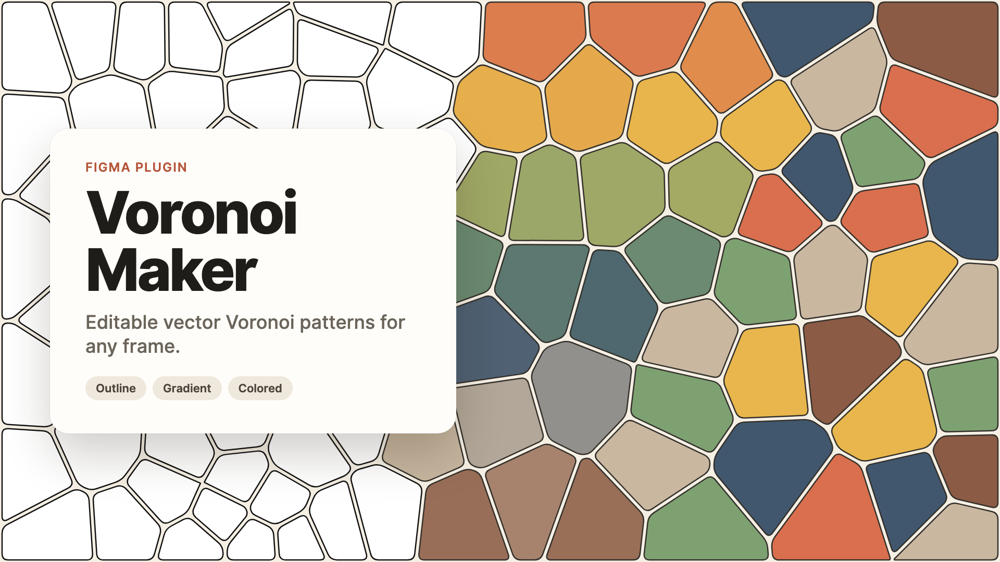
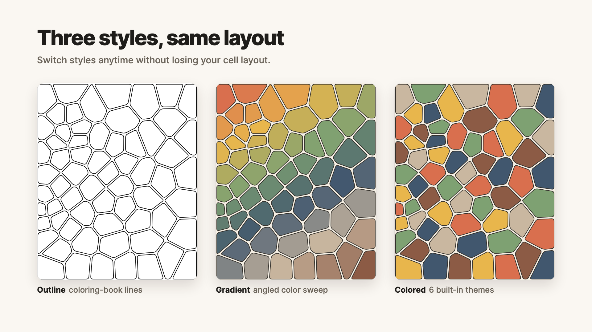
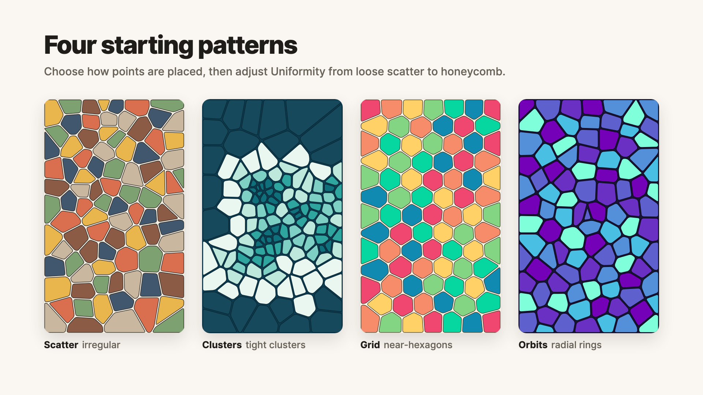
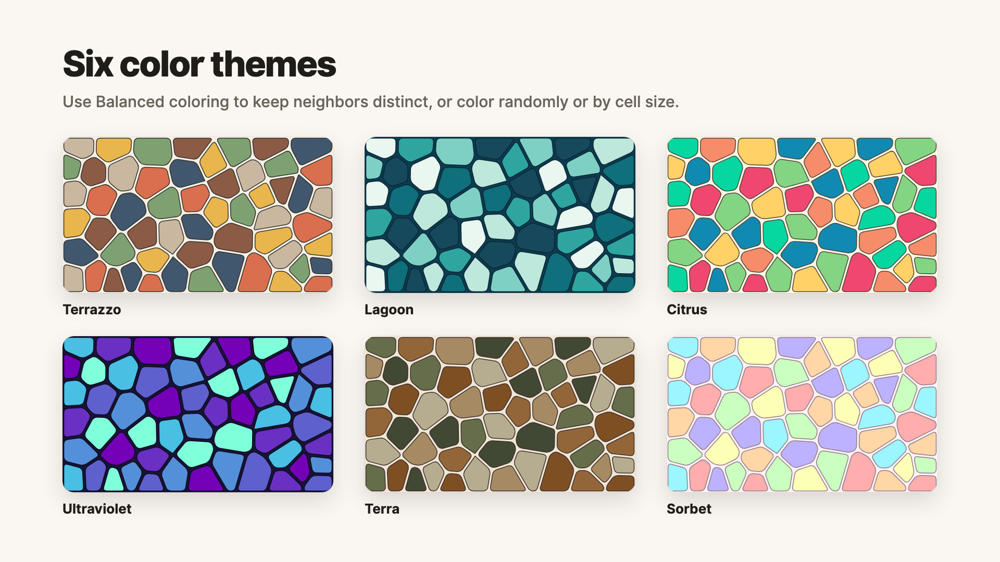
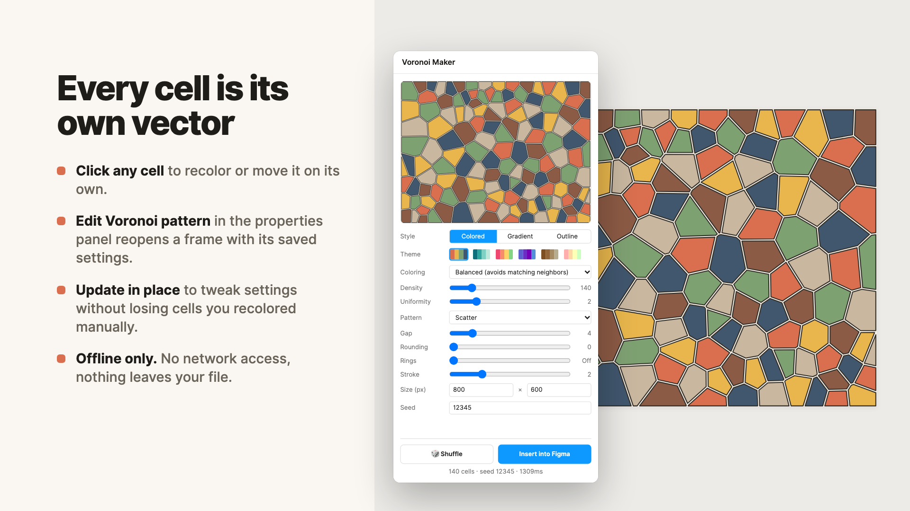

# Voronoi Maker



**Generate editable vector Voronoi patterns in Figma.**

[](https://www.figma.com/community/plugin/1707624076362663172)
[](https://www.figma.com/design/skSB3nQ1PQLBnSYQrFB37O)
[](LICENSE)

Voronoi Maker fills a frame with a Voronoi pattern as clean vector art. Every cell is a
**closed path** that becomes its own selectable vector in Figma, so you can click any
cell and recolor it after generation.

- **Three styles:** Colored, Gradient, or black Outline on white.
- **Four patterns:** scatter, clusters, grid and orbits, plus 6 curated themes.
- **Gaps, rounding and rings:** exact gutters, pebble corners and nested outlines.
- **Update in place:** change the settings later and keep the colors you picked.
- **Reproducible:** the same seed and settings always give the same pattern.

| | |
|---|---|
|  |  |
|  |  |

## Install

- **From the Figma Community:** [Voronoi Maker](https://www.figma.com/community/plugin/1707624076362663172)
  (in review with Figma; the link works once the listing is approved). Open it in any
  design file and run it from the Plugins menu.
- **Try it first:** duplicate the [Voronoi Maker playground](https://www.figma.com/design/skSB3nQ1PQLBnSYQrFB37O).
- **From source:** see [Development](#development).

## Using the plugin

- **Style**
  - *Colored*: theme fills. Pick a **Coloring** method: *Balanced* (touching cells never
    share a color when it can be avoided), *Random*, or *By cell size*.
  - *Gradient*: cells sampled from a linear gradient through the theme colors. The
    **Angle** slider sets the direction.
  - *Outline*: black outlines on white.
- **Theme**: 6 curated palettes (hidden for Outline).
- **Density**: target cell count (12 to 800).
- **Uniformity**: Lloyd relaxation steps. 0 is a raw organic scatter; 10 is close to a
  honeycomb.
- **Pattern**: how points are placed. *Scatter* (uniform), *Clusters* (dense knots with
  big calm cells between), *Grid* (jittered hex lattice), or *Orbits* (rings radiating
  from the center).
- **Gap**: an exact, even gutter between cells. Each shared edge is moved in by half the
  gap, so neighbors are exactly `gap` apart.
- **Rounding**: corner radius. With a gap, it gives a pebble or terrazzo look.
- **Rings**: nested outlines inside every cell, this many px apart (*Off* at 0). Each ring
  is the cell shrunk by one more spacing, using the same exact offset as the gap. Rings
  share the cell's rounding; a rounded corner can pinch a band to about 90% of the
  spacing (85% at maximum rounding). Big cells get more rings, and a cell less than four
  spacings across gets none. Each ring is its own closed vector, stacked on its cell and
  named after it: `Cell 042 Ring 1` is the outermost.
- **Ring shading** (Colored and Gradient, with rings on): *Fade to light* tints each ring
  a step further toward white; *Alternate* switches between the cell's color and a
  lighter tint. In Outline style, every ring is white.
- **Stroke**: outline width (0 means none in Colored and Gradient).
- **Size, Seed, Shuffle**: the same seed and settings always give the same result.
- **Insert into Figma** places the frame at the center of the view as `Voronoi <seed>`.
  The background is locked so clicks in the gaps don't grab it (unlock it in the Layers
  panel to recolor it). Click any cell to change its fill by hand.

### Update in place

While a generated frame (or any cell inside it) is selected, the main button becomes
*Update selected*. It regenerates that frame with the current settings and keeps the
fills you changed by hand:

- *Style, theme, coloring, angle, stroke, rounding, ring shading* only restyle the same
  cells, so each change stays on the same layer (`Cell 042` stays `Cell 042`).
- *Rings* keeps the cells but changes their rings. A recolored ring stays on the same
  ring number of the same cell, if that cell still has that many rings.
- *Size, density, uniformity, pattern, gap, seed* move the cells, and cells are numbered
  in order, so `Cell 042` may now be a different cell. Instead, each change follows its
  spot: the old cell's center is scaled to the new frame size, and the change goes to
  the new cell there (or, if that spot is in a gutter, the nearest cell within half a
  typical cell width). When several land on one cell, the closest wins. A recolored ring
  moves with its cell.
- A recolored background is always kept. The notification says how many changes were
  kept, for example *Kept 5 of 7 colors you changed by hand; 2 had no matching cell.*
- While a frame is selected, an *Insert new* button also appears, for when you want a
  second pattern instead.

Selecting a frame also loads its stored settings into the panel, the same thing the
**Edit Voronoi pattern** button in the properties panel does.

## Relaunch button

Every generated frame stores its full settings with `setPluginData` and gets
`setRelaunchData({ edit })`. Selecting the frame shows **Edit Voronoi pattern** in
Figma's properties panel. Clicking it reopens the plugin with that frame's settings
loaded and the button set to *Update selected*.

> **Plugin id**: `1707624076362663172`, issued by Figma. **Never change it.** Plugin data and
> relaunch buttons are tied to the id, so frames made with another id lose their stored
> settings and their **Edit Voronoi pattern** button.

## Development

### Build and import

```sh
npm install
npm run build     # writes dist/code.js, dist/ui.html, dist/core.iife.js
```

`dist/` is committed, so a fresh clone works in Figma without a build step.

In **Figma desktop**: Plugins > Development > **Import plugin from manifest…**, then pick
`manifest.json` in this folder. Run it from Plugins > Development > Voronoi Maker.

### Dev gallery (no Figma needed)

```sh
python3 -m http.server 8144   # from this folder
# then open http://localhost:8144/preview/gallery.html
```

Renders 12 combinations across all styles and patterns and runs automated checks:
the same seed gives byte-identical SVG, every path is closed, no path has NaN values,
and cell counts are sane. It also checks Update in place on a few seeds (restyling maps
every cell to itself, renumbered cells keep their changes, a 2x resize follows every
cell, merged cells never get two changes) and checks rings (every band is one spacing
wide, shading behaves, recolored rings follow their cells).

### Architecture

One pure geometry core (`src/core/`) produces an SVG string. The plugin UI shows that
SVG as the live preview, and `main.ts` inserts the *same* string with
`figma.createNodeFromSvg()`, so the preview matches the output exactly.

- `rng.ts`: seeded random numbers (mulberry32). Geometry and colors use separate streams,
  so the layout stays put when you switch themes or styles on the same seed.
- `voronoi.ts`: Voronoi cells by half-plane clipping with a spatial grid, Lloyd
  relaxation, exact insets for gaps and rings, rounded-corner paths.
- `points.ts`: the four point patterns.
- `colors.ts`: fill methods (balanced, random, by size, gradient) and ring shading.
- `palettes.ts`: the 6 themes.
- `composer.ts`: settings (clamped to safe ranges) to tessellation.
- `svg.ts`: tessellation to SVG, plus the layer-name-to-fill map used to spot fills
  changed by hand.
- `match.ts`: where each recolored layer belongs after an update.

## License and privacy

MIT, see [LICENSE](LICENSE). Everything in `dist/` is built from this repo's `src/`. No
third-party code is bundled; the only dependencies are build tools (esbuild, TypeScript,
Figma's type definitions) that never ship. The seeded random number generator is
Tommy Ettinger's public-domain mulberry32. The listing images in `community/` set their
text in Inter (SIL Open Font License); the font itself is not included.

The plugin declares no network access and collects nothing: no analytics, no accounts,
no third-party services. It reads only the current selection (to recognize frames it
made) and writes only the frames it creates. Each frame carries its own settings as
plugin data so it can be reopened, and that data stays in the Figma file.
